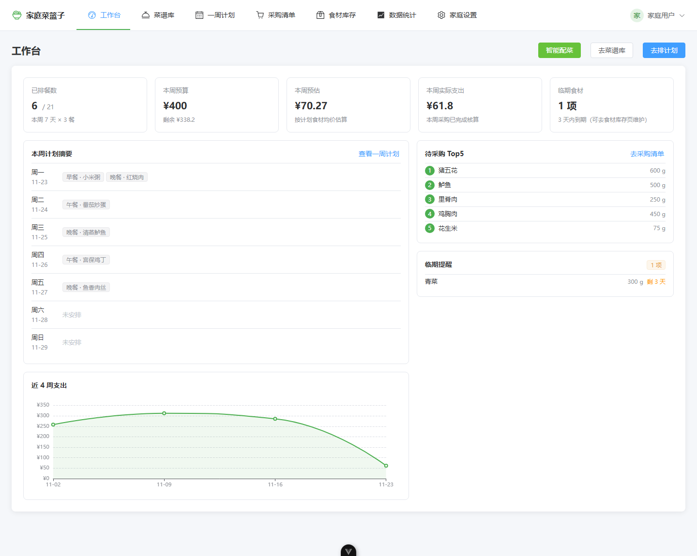
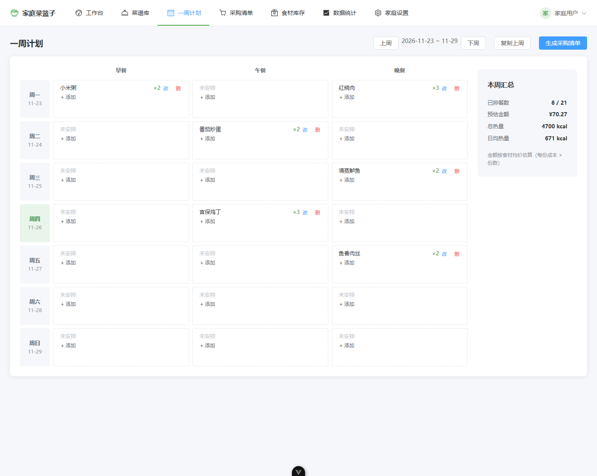
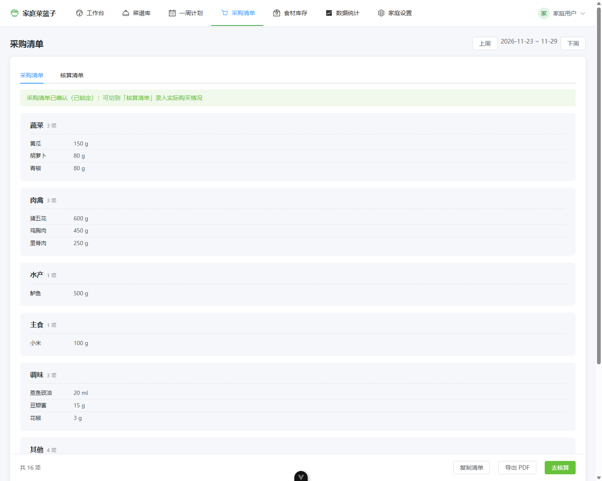
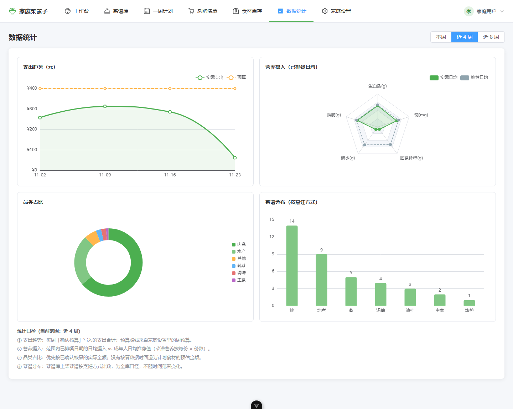
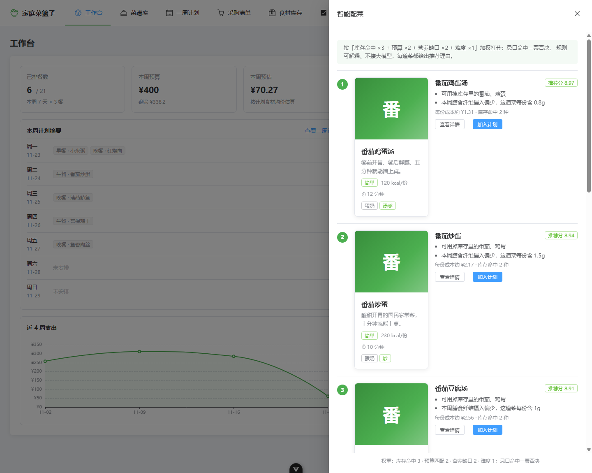

# 家庭菜篮子计划系统（vegetable-basket）

> 把「这周吃什么」变成「要买什么、花多少钱」——菜谱 → 一周计划 → 采购清单 → 预算与营养报表。

一个纯前端的家庭做饭规划 Demo：按周排菜、自动聚合采购清单、记录实际花销、用图表看预算与营养，并提供一套**可解释的规则推荐**（不接大模型）。项目用于毕业设计演示与前端实习简历展示。

## 项目截图

### 工作台



### 一周计划



### 采购清单



### 数据统计



### 智能配菜（规则推荐）



## 核心功能

- **菜谱库**：关键词 / 烹饪方式 / 品类 / 难度筛选，排序、分页、收藏、详情（食材 + 步骤 + 营养）。
- **一周计划**：7 天 × 3 餐网格，选菜抽屉加菜、改份数、删除、一键复制上周（手写深拷贝，避免引用共享）。
- **采购清单（核心算法）**：把一周计划聚合成「买什么、买多少」，内置 8 步纯函数聚合：
  收集 → 别名归一（西红柿→番茄）→ Map 合并 → 单位换算（g/kg、ml/L）→ 过滤常备调料/忌口 → 库存抵扣 → 按品类分组降序 → 整数分计价。
  支持预览、确认锁定、复制清单、导出 PDF，再进入「核算清单」录入实际分量与金额，确认后写入支出。
- **数据统计**：支出趋势（折线）、营养摄入（雷达）、品类占比（环形）、菜谱分布（柱状）；ECharts 按需引入 + `ResizeObserver` 自适应 + 卸载 `dispose`。
- **食材库存**：食材批次、购买日、自动算到期日，临期（≤3 天）/ 过期整行高亮，库存会参与采购清单的「建议采购量」抵扣。
- **家庭设置**：成员数、周预算、忌口、常备调料；修改后真正影响采购清单、预算卡与统计预算线。
- **智能配菜（S10）**：按库存、预算、本周营养缺口、难度加权打分，输出 Top7 + 可读理由，支持一键加入一周计划。
- **管理端**：菜谱 CRUD / 上下架、分类管理、食材字典管理（被引用数据会拒绝删除）。

## 技术栈

| 类别 | 技术 |
| --- | --- |
| 运行时 | Vue 3.5（`<script setup>`）、Vue Router 5、Pinia 4 + 持久化插件 |
| UI | Element Plus 2（按需自动导入）、Sass（scoped + 全局变量注入）、@element-plus/icons-vue |
| 图表 | ECharts 6（按需注册 + 封装 `useChart` / `ChartCard`） |
| 请求 | axios 1（`create` + 双拦截器 + 401 并发去重） |
| Mock | axios 自定义 adapter（内存数据、延迟、错误注入、返回深拷贝） |
| 工程 | Vite 8、ESLint 10（flat）+ Prettier 3 + oxlint、husky + lint-staged |

> 本项目没有真实后端、没有 TypeScript、没有测试框架，全部接口由 Mock 提供，便于本地演示与讲解。

## 快速开始

环境要求：Node `^22.18.0 || >=24.12.0`，包管理器 `pnpm`。

```sh
# 1. 安装依赖（会触发 husky prepare）
pnpm install

# 2. 启动开发服务器（默认 http://localhost:5173）
pnpm dev

# 3. 生产构建 + 本地预览
pnpm build
pnpm preview

# 4. 代码检查与格式化
pnpm lint
pnpm format
```

演示账号（登录页可一键填入）：

| 角色 | 账号 | 密码 | 说明 |
| --- | --- | --- | --- |
| 家庭用户 | `family` | `123456` | 菜谱 / 计划 / 采购 / 库存 / 统计 / 智能配菜 |
| 管理员 | `admin` | `123456` | 菜谱管理 / 分类管理 / 食材字典（也可直接访问 `/stats`） |

**Mock 说明**：`VITE_USE_MOCK=true` 时 axios adapter 拦截请求并读取内存种子数据；刷新页面后数据恢复初始状态，演示时按「复制上周 → 生成采购清单 → 确认核算」走一遍即可看到完整数据链路。

> 本项目没有真实后端，`.env.development` 与 `.env.production` 都默认启用 Mock，因此 `pnpm build && pnpm preview` 也能直接完整演示。接入真实后端时，把 `.env.production` 的 `VITE_USE_MOCK` 改为 `false`，并把 `VITE_API_BASE_URL` 指向后端网关即可，业务代码无需改动。

## 页面与路由

| 路由 | 角色 | 说明 |
| --- | --- | --- |
| `/login` | 公开 | 登录（用户名 5–12 位、密码 6–18 位，支持 `?redirect=` 回跳） |
| `/dashboard` | 家庭 / 管理员 | 工作台：预算、已排餐数、临期、计划摘要、待采购 Top5、智能配菜入口 |
| `/recipes`、`/recipes/:id` | 家庭 / 管理员 | 菜谱库与详情 |
| `/plan` | 家庭 | 一周计划（7×3、复制上周、份数联动汇总） |
| `/shopping` | 家庭 | 采购清单 / 核算清单双 Tab |
| `/pantry` | 家庭 | 食材库存（保质期、临期高亮） |
| `/stats` | 家庭 / 管理员 | 数据统计（4 张图 + 时间范围切换） |
| `/settings` | 家庭 | 家庭设置（成员数、周预算、忌口、常备调料） |
| `/admin/recipes`、`/admin/recipes/edit/:id?` | 管理员 | 菜谱管理 / 新增编辑 |
| `/admin/categories`、`/admin/ingredients` | 管理员 | 分类管理 / 食材字典管理 |

路由采用**动态注册**：登录后用 `meta.roles` 过滤再 `addRoute`，未注册地址在路由层不存在；404 兜底最后注册。

## 智能配菜规则（可解释，不接大模型）

打分公式（`src/utils/recommend.js`，权重集中在 `WEIGHTS` 常量）：

```
score = 3 × 库存命中食材数
      + 2 × 预算匹配度
      + 2 × 营养匹配度
      + 1 × 难度匹配度
忌口命中 → 一票否决（直接排除）
```

- **库存命中**：菜谱任意食材在库存中（数量 > 0）记 1 次命中，按食材 id 去重。
- **预算匹配**：以「周预算 ÷ 21 餐」为每餐基准，每份成本越低分越高（成本为 0 → 1 分；等于每餐预算 → 0.5 分；达到每餐预算 2 倍 → 0 分）。
- **营养匹配**：只对「建议摄入下限」的三个指标（蛋白质 / 碳水 / 膳食纤维）计算本周日均缺口，菜谱对应营养占比 × 缺口比例，取平均；脂肪、钠属于上限指标，不参与加分，避免推荐重油重盐。
- **难度匹配**：工作日偏好简单菜（简单 1 / 普通 0.67 / 困难 0.33），周末给中性分。
- **推荐理由**：按「库存命中 → 营养缺口 → 预算 → 工作日难度」优先级生成 1–2 条，例如「可用掉库存里的番茄、鸡蛋」「本周蛋白质摄入偏少，这道菜每份含 14g」。
- **加入计划**：每道菜可一键选择日期 / 餐次 / 份数（默认本周第一个空餐次），写入一周计划后工作台概览自动刷新。

> 不接大模型的原因：规则可解释、可测试、零调用成本，且每个分数都能在答辩时讲清楚。

## 采购清单聚合引擎（`src/utils/aggregate.js`）

纯函数 `aggregateShoppingList(input)` 一次性完成 8 步，输入输出都不依赖 Vue 或接口：

1. **收集**：计划项 → 菜谱食材 ×（份数 / 默认份数），四舍五入成整数；
2. **归一**：名称/别名反查标准食材（西红柿 → 番茄）；
3. **合并**：以「食材 id + 基准单位」为 key，用 `Map` 累加；
4. **换算**：g/kg、ml/L 归一到最小单位；根/把/片等不可换算单位单独分组；
5. **过滤**：常备调料、忌口食材直接排除；
6. **抵扣**：按库存扣减，部分抵扣标注「库存不足」，完全覆盖则不出现；
7. **分组**：按食材品类分组、组内数量降序；
8. **计价**：金额一律整数「分」，避免浮点误差。

## 目录结构

```text
vegetable-basket/
├─ src/
│  ├─ api/           # 接口层：auth / recipe / dict / plan / shopping / pantry / family / stats / recommend
│  ├─ components/    # 公共组件：AppMenu、PageContainer、ProTable、SearchForm、RecipeCard、ChartCard、RecommendDrawer…
│  ├─ composables/   # useTable、useDebounce、useChart
│  ├─ layouts/       # FamilyLayout（顶部导航）、AdminLayout（侧栏 + 面包屑 + 折叠）
│  ├─ mock/          # axios adapter + 内存数据 + 种子 JSON
│  ├─ router/        # 路由表（动态注册）、守卫
│  ├─ stores/        # Pinia：user（持久化）、recipe（收藏）、shopping
│  ├─ styles/        # 全局变量与 reset
│  ├─ utils/         # request、aggregate、unit、date、deepClone、echarts、recommend、permission…
│  └─ views/         # 登录、家庭端、管理端页面
├─ screenshots/      # README 功能截图
├─ docs/             # 产品/技术设计文档（内部维护，不提交公开仓库）
└─ stage/            # 阶段交付记录（内部维护，不提交公开仓库）
```

## 接口契约

统一响应：`{ code: 0, message: 'ok', data }`；分页：`{ list, total, page, pageSize }`；错误码：`400` 参数 / `401` 未登录 / `403` 无权限 / `404` 不存在 / `500` 服务端。

| 模块 | 方法 | 路径（示例） | 阶段 |
| --- | --- | --- | --- |
| 认证 | POST / GET | `/auth/login`、`/auth/me` | S2 |
| 菜谱 | GET / POST / PUT / DELETE | `/recipes`、`/recipes/:id`、`/recipes/:id/status`、`/recipes/:id/favorite` | S4/S5 |
| 字典 | GET / POST / PUT / DELETE | `/categories`、`/ingredients`（带 `page` 返回分页对象） | S5/S9 |
| 一周计划 | GET / POST / PUT / DELETE | `/plans`、`/plans/items`、`/plans/copy` | S6 |
| 采购 / 核算 | GET / POST / PATCH / DELETE | `/shopping`、`/shopping/generate`、`/shopping/account`、`/shopping/:id/confirm` | S7 |
| 库存 | GET / POST / PUT / DELETE | `/pantry` | S7/S9 |
| 家庭设置 | GET / PUT | `/family` | S9 |
| 统计 | GET | `/stats/overview`、`/stats/expense-trend`、`/stats/nutrition`、`/stats/category-share`、`/stats/recipe-distribution` | S8 |
| 智能配菜 | POST | `/ai/recommend` | S10 |

关键约定：金额一律用「分」（整数）；用量一律整数最小单位（g / ml / 个）；周日期 `YYYY-MM-DD`，一周从周一开始；Mock adapter 返回前深拷贝，模拟真实 HTTP 序列化边界。

## 构建体积自查（本地 `pnpm build` 实测）

| 产物 | 体积 | gzip | 说明 |
| --- | --- | --- | --- |
| 首屏入口 `index-*.js` | 238.73 kB | 76.11 kB | Vue + Router + Pinia + 按需引入的 Element Plus 代码 + Mock 种子数据 |
| 图表 chunk `ChartCard-*.js` | 567.88 kB | 192.33 kB | ECharts 按需注册，**懒加载**：仅统计页 / 工作台含图时下载 |
| `html2canvas` | 199.40 kB | 46.74 kB | 点击「导出 PDF」时才动态 import |
| `jspdf` | 399.68 kB | 129.91 kB | 同上 |

说明：

- Element Plus 通过 `unplugin-vue-components` 按需引入（`d.ts: false`），未全量注册组件与样式；
- ECharts 通过 `echarts/core` + `echarts.use` 只注册折线/雷达/饼/柱 + 必需组件，且只在统计/工作台路由 chunk 中加载；
- 构建仍会提示「ChartCard chunk > 500 kB」——这是 ECharts 本体体积，已通过懒加载隔离，不影响登录页与菜谱库首屏。

## 部署（暂缓）

按项目计划，**线上部署暂时搁置**（Vercel / Netlify 与 `base` 路径配置留待后续）。本地验证方式：

```sh
pnpm build
pnpm preview
```

`pnpm preview` 会启动本地静态服务器，可完整演示全部功能。若后续部署，需要按平台要求调整 `vite.config.js` 的 `base` 并重新构建。

## 已知限制

- 纯前端 + Mock：没有真实后端 / 数据库，刷新页面数据恢复种子；生产环境接入真实接口时只需切换 `VITE_USE_MOCK`。
- 智能配菜为**规则算法**，不是大模型推荐；权重与口径见上文。
- 管理员端顶部/侧栏未加入「工作台 / 数据统计」入口（S2 布局既有结构），可手动访问 `/dashboard`、`/stats`。
- 分类改名不会追溯历史采购清单里的分类快照；食材单价 / 基准单位调整只影响之后生成的清单。

## 数据与许可

- 菜谱种子数据参考 [HowToCook](https://github.com/Anduin2017/HowToCook)（Unlicense / 公有领域）的数据结构整理，仅用于学习与演示。
- 项目代码用于个人毕业设计与简历展示。
